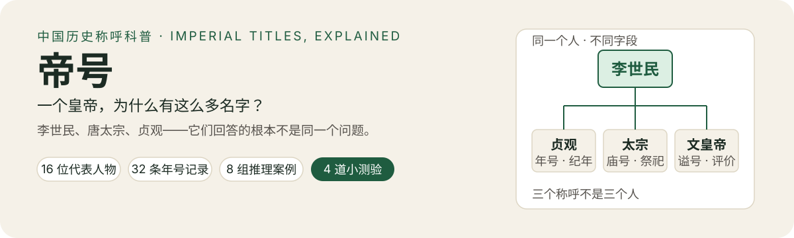
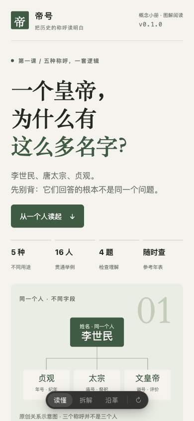
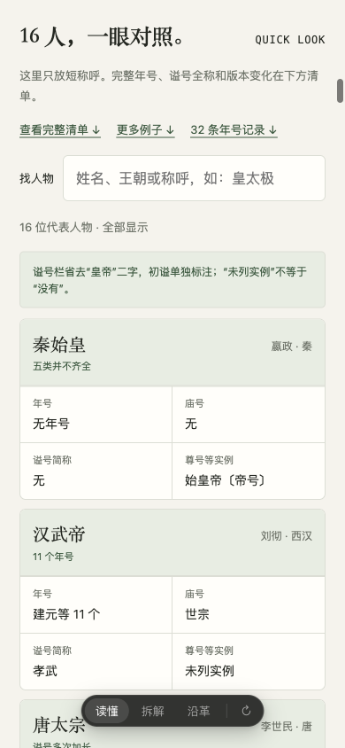

<p align="right"><a href="README.md">中文</a></p>

<p align="center">
  
</p>

<p align="center">
  <a href="https://dihao.xiaosang.cc/">▶ Read Online</a>
  ·
  <a href="https://github.com/holynova/dihao">GitHub Repository</a>
</p>

A mobile-first explainer of Chinese imperial titles: plain language and diagrams for personal names, era names, temple names, posthumous names and honorary titles — five kinds of names that answer five different questions. 16 representative rulers, 32 era records, 8 worked examples, and a 4-question quiz; with search, dynasty filters, a year converter, and JSON download.

## Screenshots

<p align="center">
  
  
</p>

## Five Names, One Logic

| Name | The question it answers | Example (李世民 Li Shimin) |
|---|---|---|
| 姓名 Personal name | Who is he | 李世民 Li Shimin |
| 年号 Era name | Which year (dating) | 贞观 Zhenguan (627–649) |
| 庙号 Temple name | How he is addressed in ancestral rites | 太宗 Taizong |
| 谥号 Posthumous name | How he is judged after death | 文皇帝 Emperor Wen (original posthumous name) |
| 尊号 Honorary title | The exalted title courtiers petitioned for during his life | 天可汗 Tian Kehan ("Heavenly Khan", a title used in a specific political context) |

When judging a title, first ask whether it points at the person, marks a time, fixes a ritual address, or passes judgment and honor — use and context are more reliable than the literal words.

## Contents

- **16 representative rulers**: 嬴政 Ying Zheng, 刘彻 Liu Che, 李世民 Li Shimin, 李隆基 Li Longji, 赵匡胤 Zhao Kuangyin, 忽必烈 Kublai Khan, 朱元璋 Zhu Yuanzhang, 朱棣 Zhu Di, 朱祁镇 Zhu Qizhen, 朱翊钧 Zhu Yijun, 皇太极 Hong Taiji, 福临 Fulin, 玄烨 Xuanye, 胤禛 Yinzhen, 弘历 Hongli, 溥仪 Puyi (Qin to Qing, including Later Jin).
- **32 era records**: every ruler's era names listed in full (e.g. 刘彻 Liu Che's 11, starting with 建元 Jianyuan); 嬴政 Ying Zheng had no era name.
- **8 worked examples**: why is it 唐太宗 Emperor Taizong of Tang one moment and 汉武帝 Emperor Wu of Han the next? Are 唐太宗 Taizong of Tang and 清太宗 Taizong of Qing the same person? (No — "太宗 Taizong" repeats across dynasties.) How should the whole string "开元神武皇帝" be read? (As an honorary title.)
- **4-question quiz**: it checks understanding, not memorization (e.g. the "太宗" in "唐太宗" is a temple name; "康熙三年" is first and foremost a date).
- **Three directions**: 读懂 (Understand), 拆解 (Break down), 沿革 (Trace the evolution) — 读懂 opens by default.

## Features

- **Search and dynasty filters**: find a ruler by name, dynasty or title.
- **Era-year converter**: era names against CE years (e.g. 贞观 Zhenguan, 627–649).
- **Full titles expanded by default**: complete posthumous names and key version changes shown directly, with sources noted.
- **JSON download**: the full catalogue, extra examples and all 32 era records are downloadable; display and download data come from the same `data/history-catalogue.json`.
- **Source links**: every ruler carries links to source material (e.g. Palace Museum pages, the *Draft History of Qing*), verifiable item by item.

## Content Scope

This edition is not a complete catalogue of every emperor: it covers 16 representative rulers; era names cover those 16 only; full posthumous names and key versions cite their sources; honorary titles list only verifiable instances, with no claim to exhaust every bestowal. Early Han era-name naming involves retrospective-recording debates; date ranges are the CE years involved, not a substitute for a month/day calendar. Reign years, era-change years, original posthumous names, added posthumous names, changed temple names and final short forms are kept distinct; private posthumous appellations are not mixed into official temple and posthumous names. See [Content scope](./docs/CONTENT_SCOPE.md).

The original diagrams on the site are explanatory illustrations, not historical portraits.

## Run Locally

```bash
npm ci
npm run build    # Injects data/history-catalogue.json into the page and copies the public JSON
npm run check    # Data validation
```

To edit ruler data, change `data/history-catalogue.json` and re-run `npm run build`, so the display and the download stay consistent.

## Tech

- Pure HTML + CSS + JS, zero frameworks; the build script injects JSON data into `src/index.html` to produce the published page.
- Mobile-first, 390px portrait layout; the three directions (读懂 / 拆解 / 沿革) switch from the bottom bar.

```
src/index.html              Page template (data injected at build time)
data/history-catalogue.json Complete data for 16 rulers (era names / posthumous-name versions / sources)
scripts/build.mjs           Data injection + public JSON copy
scripts/check.mjs           Data validation
docs/CONTENT_SCOPE.md       Content scope and editorial principles
```
