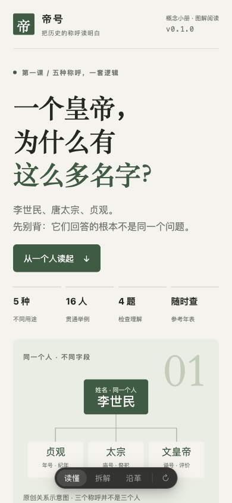

# 帝号 / Dihao

中文：移动端优先的皇帝称呼科普网页。用白话和关系图解释姓名、年号、庙号、谥号与尊号；包含16位代表人物、32条年号记录、八组推理案例和小测验。主表便于扫读，完整称号与版本变化默认展开，支持搜索、王朝筛选和年号换算。保留“读懂、拆解、沿革”三个方向，默认打开读懂。

English: A mobile-first Chinese history explainer about imperial names, era names, temple names, posthumous names and honorary titles. Includes 16 representative rulers, 32 era records, eight worked examples, searchable source-linked reference lists, a year converter and quizzes. Three interactive directions remain available.



## 在线体验 / Live Demo

- [Cloudflare Demo](https://dihao.xiaosang.cc/)（上线验证中 / Verification in progress）
- [GitHub Repo](https://github.com/holynova/dihao)


## 本地运行 / Run locally

```bash
npm ci
npm run dev
```

## 检查与发布 / Check and deploy

```bash
npm run deploy:check
npm run deploy
```

Cloudflare Workers · Domain: `dihao.xiaosang.cc` · Version: `0.1.0`.

Source and deployment configuration use `main`. Deploy locally with Wrangler; no Cloudflare build branch or deployment workflow.

## 内容范围 / Content scope

本版不是历代皇帝全集。年号名称覆盖所收录16人；谥号全称与关键版本标明出处；尊号仅列可核对实例。资料年份不替代月日历表。详见 [Content scope](./docs/CONTENT_SCOPE.md)。

The catalogue is representative rather than exhaustive. Sources and version notes remain visible. Edit `data/history-catalogue.json`, then build to keep displayed and downloadable data aligned.
