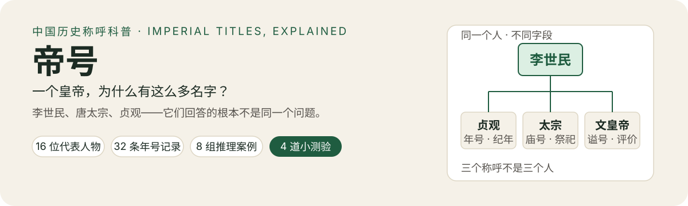
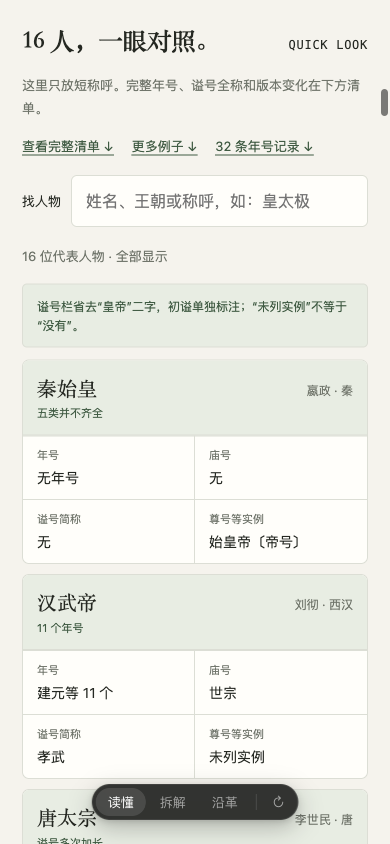

<p align="center">
  
</p>

<p align="center">
  <a href="https://dihao.xiaosang.cc/">▶ 在线阅读 Read Online</a>
  ·
  <a href="https://github.com/holynova/dihao">GitHub 仓库</a>
</p>

移动端优先的中国历史称呼科普：用白话和关系图解释姓名、年号、庙号、谥号与尊号——五种称呼回答的根本不是同一个问题。收录 16 位代表人物、32 条年号记录、8 组推理案例与 4 道小测验；支持搜索、王朝筛选、年号换算与 JSON 下载。

A mobile-first explainer of Chinese imperial titles: plain language and diagrams for personal names, era names, temple names, posthumous names and honorary titles — five kinds of names that answer five different questions. 16 representative rulers, 32 era records, 8 worked examples, and a 4-question quiz; with search, dynasty filters, a year converter, and JSON download.

## 截图 / Screenshots

<p align="center">
  
  
</p>

## 五种称呼，一套逻辑 / Five Names, One Logic

| 称呼 | 回答的问题 | 例子（李世民） |
|---|---|---|
| 姓名 | 他本人是谁 | 李世民 |
| 年号 | 哪一年（纪年） | 贞观（627—649） |
| 庙号 | 宗庙祭祀时怎么称呼 | 太宗 |
| 谥号 | 去世后如何评价 | 文皇帝（初谥） |
| 尊号 | 生前群臣请上的尊崇称号 | 天可汗（特定政治语境的尊称） |

判断称呼时，先问它在指人、标时间、定祭祀称呼，还是在作评价与尊崇——用途和上下文比字面更可靠。

## 内容 / Contents

- **16 位代表人物**：嬴政、刘彻、李世民、李隆基、赵匡胤、忽必烈、朱元璋、朱棣、朱祁镇、朱翊钧、皇太极、福临、玄烨、胤禛、弘历、溥仪（秦至清，含后金）。
- **32 条年号记录**：各人年号名称列全（如刘彻建元等 11 个）；嬴政无年号。
- **8 组推理案例**：为什么一会儿唐太宗、一会儿汉武帝？唐太宗与清太宗是同一个人？（不是——"太宗"会跨王朝重复。）"开元神武皇帝"整串应怎样理解？（尊号。）
- **4 道小测验**：检查理解而非死记（如"唐太宗"的"太宗"是庙号；"康熙三年"首先是纪年）。
- **三个方向**：读懂、拆解、沿革，默认打开"读懂"。

## 功能 / Features

- **搜索与王朝筛选**：按姓名、王朝或称呼找人物。
- **年号换算**：年号与公元年份对照（如贞观 627—649）。
- **完整称号默认展开**：谥号全称与关键版本变化直接可见，标明出处。
- **JSON 下载**：完整清单、更多例子与 32 条年号记录均可下载，数据与页面展示由同一 `data/history-catalogue.json` 生成。
- **出处链接**：每人附资料来源链接（如故宫网页、《清史稿》），可逐条核对。

## 内容范围 / Content Scope

本版不是历代皇帝全集：收录 16 位代表人物；年号名称覆盖所收录 16 人；谥号全称与关键版本标明出处；尊号仅列可核对实例，不声称穷尽历次授号。早期汉代年号命名存在追记讨论；日期范围为涉及的公元年份，不替代月日历表。明确区分在位年份、改元年份、初谥、加谥、改庙号和末段简称；私人追称不混入官定庙谥。详见 [Content scope](./docs/CONTENT_SCOPE.md)。

页面原创关系图均为解释示意图，不是文物画像。

## 本地运行 / Run Locally

```bash
npm ci
npm run build    # 把 data/history-catalogue.json 注入页面并复制公开 JSON
npm run check    # 数据校验
```

修改人物资料时编辑 `data/history-catalogue.json`，再 `npm run build`，避免展示与下载数据不一致。

## 技术 / Tech

- 纯 HTML + CSS + JS，零框架；构建脚本把 JSON 数据注入 `src/index.html` 生成发布页面。
- 移动端优先，390px 竖屏排版；三个方向（读懂 / 拆解 / 沿革）底部切换。

```
src/index.html              页面模板（数据由构建注入）
data/history-catalogue.json 16 人完整数据（年号 / 谥号版本 / 出处）
scripts/build.mjs           数据注入 + 公开 JSON 复制
scripts/check.mjs           数据校验
docs/CONTENT_SCOPE.md       内容范围与编辑原则
```

## English

**帝号 (Dihao)** — a mobile-first explainer that answers a deceptively simple question: why does one emperor have so many names? Because the five kinds of names answer five different questions.

- **The five names**: personal name (who he is — 李世民), era name (which year — 贞观 627–649), temple name (how he is addressed in ancestral rites — 太宗), posthumous name (how he is judged after death — 文皇帝), honorary title (bestowed by courtiers during his life).
- **Contents**: 16 representative rulers (Qin to Qing), 32 era records (every era name listed per ruler; 嬴政 had none), 8 worked examples (e.g. 唐太宗 vs 清太宗 are different people — "太宗" repeats across dynasties), and a 4-question quiz.
- **Features**: search and dynasty filters, an era-to-CE year converter, fully expanded posthumous-name versions with sources, JSON download of the full catalogue, and per-ruler source links.
- **Scope**: representative, not exhaustive — 16 rulers only; honorary titles list only verifiable instances. See `docs/CONTENT_SCOPE.md`. Diagrams are explanatory illustrations, not historical portraits.
- **Tech**: plain HTML + CSS + JS, zero frameworks; `npm run build` injects `data/history-catalogue.json` into the page.
- **Run it**: `npm ci && npm run build`.
